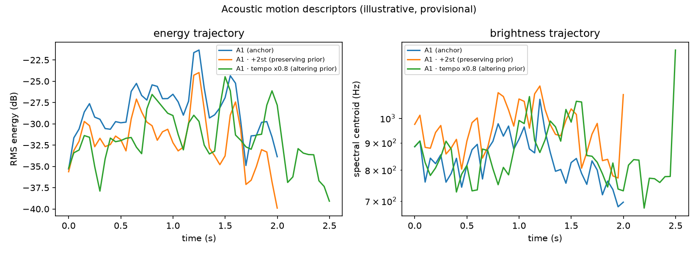
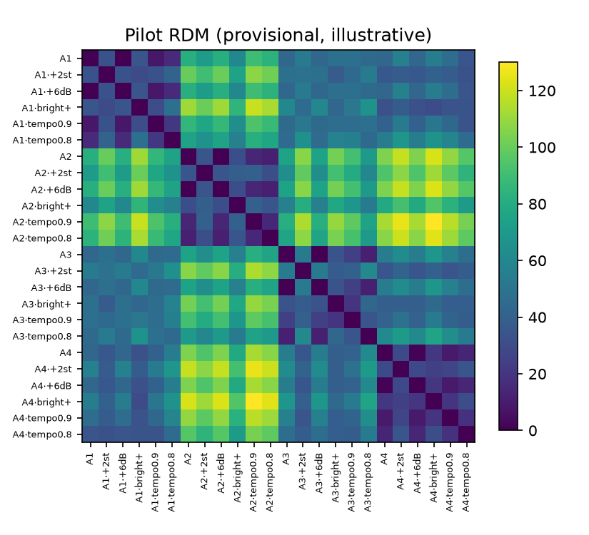
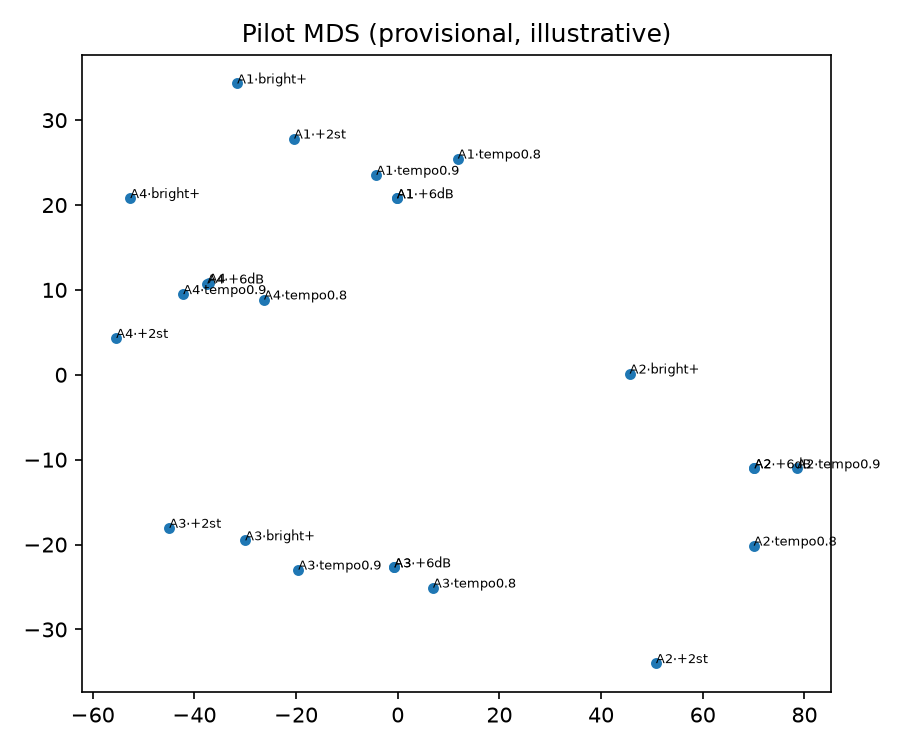

# Testing the Continuous Perceptual Trajectory Hypothesis for Musical Motion: A Preregistered Protocol and Open Framework

**Author:** Feng Yuhan (fengru@gmail.com)

**Status:** protocol + framework paper. The human study is preregistered and the
pilot infrastructure is released; empirical human results are not yet collected,
and no claim about musical motion is made.

---

## Abstract

We ask whether musical intent ("gesture") can be represented as a continuous
latent trajectory over time, and we argue that the central obstacle is not
modeling capacity but **identification**. A representation trained on top of
assumed gesture-preserving transformations can trivially "succeed" and still
carry no musical-motion information, because the transformations, the notion of a
negative gesture, the alignment convention, and the evaluation metric are all
researcher-defined. We formalize six threats to validity (T1–T6) and derive, for
each, a concrete mitigation. We then present a framework whose design is forced
by those mitigations: (i) transformations are a *parameterized hypothesis* whose
semantics are established by human ratings before use as positives; (ii)
variable-length trajectory distances are reported in raw, length-normalized, and
dynamic-time-warped forms, with the normalized form primary; (iii) representation
collapse is an independent pass/fail criterion, enforced during training by
VICReg-style variance and covariance terms; (iv) continuity is expressed as
multi-step predictability, never as an L2 penalty on adjacent latents; (v)
success is a conjunction of criteria that explicitly includes losing to stronger
baselines. We release an open-source implementation and a pilot on 40 solo-piano
excerpts from MAESTRO (160 segments, 1,600 controlled variants) plus a 400-trial
human rating study that fixes the transformation ontology at the
`(transform, parameter)` level, allowing a perceptual boundary to be estimated
rather than a binary label asserted. We report only engineering validation here.

**Keywords:** musical gesture, perceptual trajectory, representation learning,
self-supervised audio, preregistration, identification.

---

## 1. Introduction

### 1.1 Motivation

Systems that generate, accompany, or edit music increasingly need a handle on
high-level musical intent: not "which notes" or "which waveform," but *how the
music moves* — whether a phrase pushes upward, relaxes, accelerates, or resolves.
A natural internal object for such intent is a **continuous perceptual
trajectory**: a time-indexed latent state

$$
z_{1:T} = f(x_{1:T}), \qquad z_t \in \mathbb{R}^d,
$$

where `x_{1:T}` is an audio excerpt and a **gesture** is a temporally localized
segment of the trajectory,

$$
G = \{z_t\}_{t=a}^{b}, \qquad 0 \le a < b \le T .
$$

This representation is attractive because it promises continuity (nearby states
are related), compositionality (gestures concatenate), editability (modify a
sub-trajectory), and prediction (extrapolate the trajectory). The idea resonates
with a long tradition treating musical gesture as sound-related movement
[Godøy & Leman 2010; Meyer 1956].

### 1.2 The trajectory hypothesis

We make the hypothesis explicit and falsifiable. Let `f` be an encoder, `T` a
transformation family, and `d` a distance on trajectories. Define the
**realization set** of an excerpt `x` under a set of realizational
transformations `𝒯_preserve` as

$$
\mathcal{R}(x) = \{\, T(x) \;:\; T \in \mathcal{T}_{\text{preserve}} \,\}.
$$

The trajectory hypothesis is the conjunction of four sub-hypotheses:

- **H1 (perceptual meaningfulness).** There exists an encoder `f` such that `d`
  in `z`-space predicts human judgments of *perceived musical motion similarity*
  better than strong acoustic and self-supervised baselines.
- **H2 (invariance to realization).** For `T` that humans agree preserves motion,
  `d(f(x), f(T(x)))` is small relative to `d(f(x), f(y))` for a genuinely
  different `y`.
- **H3 (predictability).** `z_{1:T}` supports multi-step prediction better than
  extrapolation or frozen-feature baselines, i.e., the trajectory carries
  structure beyond local smoothness.
- **H4 (local editability).** A localized error `e_t = d(z_t, ẑ_t)` identifies an
  interval whose regeneration corrects an intent error without collateral change
  elsewhere.

H4 is deliberately placed last: it is only meaningful if H1–H3 hold, because
"editing" is defined relative to a validated trajectory. The framework therefore
defers generation and editing, and treats them as downstream consequences rather
than as evidence.

### 1.3 Contributions

1. **An identification analysis (§3).** Six threats that make gesture-
   representation claims inflate, with a worked shortcut construction showing
   that each mitigation alone is insufficient; only their conjunction removes the
   obvious degenerate solutions.
2. **A parameterized human ontology (§4.3).** A rating protocol and estimator
   that classify each `(transform, parameter)` setting into
   `preserving / altering / ambiguous / uncertain`, with inter-rater agreement as a
   gate. This estimates a perceptual boundary — e.g., in tempo change — instead of
   asserting a binary status.
3. **A preregistered criterion set and statistical plan (§5).** Success is a
   conjunction (C1–C5) that includes "loses to MERT/CLAP/handcrafted" as an
   explicit failure condition.
4. **An open framework and pilot (§6–§9).** Code, a static human-study runner,
   MAESTRO subset manifests, 160 segments, and 1,600 controlled variants; the
   pipeline is released with reproduction instructions.

### 1.4 Related work

**Music and audio representation learning.** MERT [Li et al. 2024] and MusicFM
[Won et al. 2024] learn general-purpose music embeddings by masked acoustic
modeling; CLAP [Elizalde et al. 2023; Wu et al. 2023] aligns audio with text;
CLaMP [Wu et al. 2023] aligns symbolic music with text. These provide strong
frozen features and are exactly the baselines our human-alignment criterion must
beat.

**Invariance-based audio SSL.** COLA [Saeed et al. 2021] and BYOL-A [Niizumi et
al. 2021] learn representations stable under augmentation. They are close in
spirit to H2 but typically evaluate on downstream classification, not on a
human-defined motion geometry, and they do not treat transformation semantics as
an empirical object.

**Predictive representation learning.** Joint-embedding predictive architectures
(I-JEPA [Assran et al. 2023]; V-JEPA [Bardes et al. 2024]) combine invariance with
prediction in latent space. Our framework is compatible with these objectives but
is agnostic to the encoder; the contribution is the protocol that decides whether
*any* representation can be said to capture musical motion.

**Anti-collapse.** VICReg [Bardes et al. 2022] and the alignment–uniformity view
[Wang & Isola 2020] motivate our mandatory variance/covariance terms. We treat
collapse not as a training nuisance but as a scientific criterion.

**Gesture and perception.** The gesture literature [Godøy & Leman 2010; Meyer
1956] motivates the construct; our contribution is to operationalize it in a way
that can be measured and, importantly, falsified.

### 1.5 Scope and non-goals

We restrict the pilot to **solo piano**. This is not a claim about music in
general; it controls timbre, polyphony, and vocal semantics so that
transformation semantics can be established cleanly. We explicitly do **not**
propose a generative model, a decoder, or an editing system in this phase; those
are downstream and are only admissible if H1–H3 hold. We also do not claim that
"gesture" is the right ontology — the framework is designed so that this can come
out false.

---

## 2. Setup and notation

### 2.1 Audio and segmentation

Let `x ∈ ℝ^{N}` be a mono waveform at sample rate `s`. A **segmenter** produces
candidate excerpts `S = {x^{(i)}}` by fixed-window slicing at durations
`𝒟 = {d_1, …, d_k}` with hop `h = ρ·d` (we use `ρ = 1/2`). A window is retained
if its RMS level exceeds `ℓ_min` dBFS:

$$
\mathrm{dB}(x^{(i)}) = 20 \log_{10}\!\left(\sqrt{\tfrac{1}{|x^{(i)}|}\textstyle\sum_n (x^{(i)}_n)^2} + \epsilon\right) > \ell_{\min}.
$$

Fixed-window segmentation is a deliberate choice: it avoids importing an
unvalidated gesture-segmentation model into the ontology (see T1). Human
segmentation is deferred to a later phase.

### 2.2 Gesture as a trajectory segment

A frame encoder `f_φ` maps audio to a sequence; a temporal encoder `g_θ` maps the
sequence to a low-dimensional trajectory:

$$
z_{1:T} = g_\theta\big(f_\phi(x)\big), \qquad f_\phi \text{ frozen}, \quad z_t \in \mathbb{R}^d, \; d \ll \dim f_\phi.
$$

The bottleneck `d` is part of H3: a representation that memorizes the frame
features can predict trivially without learning structure.

### 2.3 Transformations and realization

A transformation `T_ψ` maps audio to audio, `T_ψ: x ↦ x'`. A **setting** is a pair
`(transform, ψ)`. We write `𝒯` for the set of settings. Realizational
transformations (hypothesized motion-preserving) induce `ℛ(x)` above. Crucially,
the partition `𝒯 = 𝒯_preserve ⊔ 𝒯_alter ⊔ 𝒯_ambiguous` is **not assumed**; it is
estimated in §4.3.

### 2.4 Distance on variable-length trajectories

Tempo-like transforms change `T`, so `d` must specify an alignment. We define
three distances between trajectories `a = a_{1:T_a}` and `b = b_{1:T_b}`:

**Raw.** Truncate to the shorter sequence and average frame-wise L2:

$$
d_{\text{raw}}(a,b) = \frac{1}{\min(T_a,T_b)} \sum_{t=1}^{\min(T_a,T_b)} \lVert a_t - b_t \rVert_2 .
$$

**Normalized (primary).** Resample both trajectories to a common length `L` on a
normalized time axis `[0,1]` by linear interpolation, `ã = R(a, L)`,
`b̃ = R(b, L)`, then

$$
d_{\text{norm}}(a,b) = \frac{1}{L} \sum_{t=1}^{L} \lVert \tilde a_t - \tilde b_t \rVert_2 .
$$

**Dynamic time warping (robustness only).** The normalized DTW cost [Sakoe &
Chiba 1978]:

$$
d_{\text{dtw}}(a,b) = \frac{1}{|W|}\min_{W} \sum_{(i,j)\in W} \lVert a_i - b_j \rVert_2 .
$$

`d_norm` is primary because it tests invariance to *rate* without letting DTW
absorb genuine trajectory differences; DTW is reported to show that conclusions
do not hinge on the alignment convention (T2). Distances are computed on
per-dimension standardized features when `normalized = true`, so that no single
high-variance dimension dominates.

### 2.5 Model geometry and RSA

Given embeddings `{e_i}`, the representational dissimilarity matrix (RDM) is the
condensed vector `RDM_model = pdist({e_i}, d)`. A human RDM `RDM_human` is built
from the rating study (or triplet choices). Model–human alignment is the
Spearman correlation of the two condensed RDMs [Kriegeskorte et al. 2008]:

$$
\mathrm{RSA} = \rho_{\text{Spearman}}\big(RDM_{\text{model}},\, RDM_{\text{human}}\big).
$$

We also report triplet accuracy `P(d(a,p) < d(a,n))` using the human-labeled
positive/negative, which avoids assuming a parametric relation.

---

## 3. The identification problem

We now formalize why H1–H3 are easy to satisfy spuriously. The core issue is that
every component of the test — positives, negatives, alignment, and metric — is
chosen by the researcher. We give the threats and a construction showing that
mitigations are not independent.

### 3.1 T1 — Transformation semantics are assumed, not measured

Suppose we declare `𝒯_preserve = {transposition, gain, brightness}` and train `f`
to minimize invariance on `𝒯_preserve`. Consider the degenerate-but-valid encoder

$$
f_{\text{pc}}(x) = \text{pitch-class histogram}(x),
$$

which discards onset timing, contour shape, and duration. It is *exactly* invariant
to transposition, gain, and timbre, so `d(f_pc(x), f_pc(T(x))) = 0` for all
`T ∈ 𝒯_preserve`, and it will "pass" any invariance test built on those
positives — **while being unable to represent motion at all**, since all timing
information is gone. The failure is not the encoder; it is the test. If a setting
does not actually preserve perceived motion, or if the positive family is too
easy, invariance is uninformative. Mitigation: estimate the partition of `𝒯`
from human ratings, and *never* use an unvalidated setting as a positive.

### 3.2 T2 — Variable-length trajectories

If `d` is chosen as `d_norm`, a temporally warped trajectory can be made
arbitrarily close to its original by interpolation; if chosen as `d_dtw`, a
sufficiently flexible warping can align a slowly rising contour to a fast one.
Thus the *same* representation can pass or fail H2 depending on the metric.
Mitigation: preregister `d_norm` as primary, report `d_raw` and `d_dtw`, and
require the conclusion to hold under at least two of the three (reported, not
silently selected).

### 3.3 T3 — Collapse

Let `f_c(x) = c` for a constant `c`. Then for all `x, y`:

$$
d(f_c(x), f_c(y)) = 0, \qquad d(f_c(x), f_c(T(x))) = 0 .
$$

`f_c` satisfies H2 perfectly and minimizes any continuity penalty, yet its RDM is
all zeros and its RDMs-informativeness (effective rank) is zero. An invariance
number reported alone is therefore meaningless. Mitigation: collapse is a
separate, mandatory criterion (C1) computed as mean per-dimension variance and
effective rank, and the training objective always contains variance/covariance
regularization.

### 3.4 T4 — Trivial prediction

If `z_t ≈ z_{t-1}` (a smooth trajectory), persistence predicts the next step
almost perfectly, so one-step prediction `‖z_{t+1} − ẑ_{t+1}‖` is uninformative.
Mitigation: the prediction task is **multi-step** and the baselines include
persistence, least-squares linear extrapolation, ridge regression on frozen
features, and the global mean; the learned trajectory must beat all of them
(C5). The bottleneck `d` further prevents trivial memorization.

### 3.5 T5 — Unfair baselines

A learned encoder trained with invariance and prediction is compared to a frozen
self-supervised model trained for another objective. Any gain may come from the
objective, not the representation. Mitigation: baselines are reported *as-is*, and
we additionally separate architecture ablations from objective ablations over a
common frozen encoder, so the source of any gain is attributable.

### 3.6 T6 — Construct ambiguity

"Are these two similar?" conflates motion with emotion, tension, loudness,
tempo, or timbre. Low inter-rater agreement then reflects an under-specified
construct, not perceptual subtlety. Mitigation: one named construct, *perceived
musical motion similarity*, with a focused prompt (below), agreement statistics
(Krippendorff's `α`, Fleiss' `κ`), and a minimum-rater gate before any setting is
treated as informative.

### 3.7 Why a conjunction

The constructions above are not independent. A constant encoder defeats
invariance and continuity; a pitch-class histogram defeats invariance while
losing motion; a smooth representation passes one-step prediction; a flexible
metric rescues a bad representation. No single mitigation removes all shortcuts.
The claim is therefore only meaningful as a **conjunction** (C1–C5), and the
framework is built so that any single failure is surfaced explicitly.

---

## 4. Framework

### 4.1 Segmentation

Durations `𝒟 = {1, 2, 4}` s (`{0.5, 1, 2, 4, 8}` s supported), hop ratio
`ρ = 1/2`, target rate 22.05 kHz, `ℓ_min = −50` dBFS, and at most `m` segments
per source (pilot `m = 4`). Candidates are filtered *before* any file is written,
so the pilot produces `O(#sources × m)` segments rather than `O(#windows)`.

### 4.2 Parameterized transformations

We apply four families with explicit grids (Table 1). Each setting is
independent; the hypothesis column is a *prior* only.

| Transform | Family | Parameter grid | Prior |
|---|---|---|---|
| `pitch_shift` | pitch | semitones `{+2, −3}` | preserving |
| `gain` | dynamics | dB `{+6, −6}` | preserving |
| `brightness` | timbre | high-shelf dB `{+9, −9}` | preserving |
| `time_stretch` | tempo | rate `{0.8, 0.9, 1.1, 1.25}` | ambiguous |

*Table 1: Parameterized transforms. A transform with disagreeing settings is
labeled `mixed`.*

`brightness` is a high-shelf filter (`y = y_low + g·(y − y_low)` with a one-pole
lowpass) approximating a timbral change. Articulation changes are intentionally
absent because they require note-level edits (MIDI); this is recorded as a known
gap rather than approximated.



*Figure 1: Acoustic motion descriptors (illustrative; provisional ontology).
Transposition preserves the energy shape and raises the brightness trajectory;
the strong tempo change preserves the shape while changing duration. This
motivates the trajectory view but is not a representation result.*

### 4.3 Human ontology validation

**Task.** For each anchor `A` and variant `B = T(A)`, a rater answers one
question on a 7-point scale:

> "A and B are two versions of the same musical excerpt. Rate how similar B's
> musical motion is to A's, from 1 (very different) to 7 (same motion)."

The prompt is fixed and names exactly one construct (T6). Anchors and variants
are presented in a static HTML page with in-page audio, so the study needs no
server and works from `file://`.

**Aggregation.** Responses are grouped by setting `k = (transform, ψ)`. For each
`k` we compute the mean, a bootstrap 95% CI [Efron & Tibshirani 1993], the
per-response category distribution

$$
\pi_k(c) = \frac{1}{|R_k|}\sum_{r \in R_k} \mathbb{1}\!\left[\,\text{cat}(r) = c \,\right], \quad c \in \{\text{preserving}, \text{ambiguous}, \text{altering}\},
$$

where `cat(r) = preserving` if `r ≥ mid + margin`, `altering` if
`r ≤ mid − margin`, else `ambiguous`, and inter-rater agreement via
Krippendorff's ordinal `α` [Krippendorff 2004] and, for complete designs, Fleiss'
`κ` [Fleiss 1971].

**Classification.** With `mid = 4.0`, `margin = 0.5`, minimum raters `R_min`,
minimum trials `N_min`, and minimum agreement `α_min`:

$$
\text{status}(k) =
\begin{cases}
\text{uncertain} & \text{if } n_{\text{raters}} < R_{\min} \text{ or } n_{\text{trials}} < N_{\min} \text{ or } \alpha_k < \alpha_{\min},\\
\text{preserving} & \text{else if } \mathrm{CI}^{\text{lo}}_k \ge mid + margin,\\
\text{altering} & \text{else if } \mathrm{CI}^{\text{hi}}_k \le mid - margin,\\
\text{ambiguous} & \text{otherwise.}
\end{cases}
$$

A transform is `mixed` if its settings disagree. The ontology records raw
distributions, so any downstream choice is auditable and re-scoring does not
require the ratings again. Two properties matter: (i) `uncertain` settings are
excluded from the invariance decision, and (ii) the human ontology is computed
**before** any representation is evaluated, which breaks the circularity of
using model output to define the construct.

### 4.4 Representations

We compare four frozen encoders and one learned model:

1. **Handcrafted ("acoustic")**: per-frame RMS, spectral centroid, spectral
   bandwidth, zero-crossing rate, onset strength, and `f0` (via `pyin`),
   z-scored per dimension.
2. **Log-mel**: 64-bin log-mel frames at a fixed hop.
3. **Frozen MERT** [Li et al. 2024]: hidden states from a mid layer, mean-pooled
   to a fixed frame rate.
4. **Frozen CLAP** [Elizalde et al. 2023; Wu et al. 2023]: windowed audio
   embeddings.
5. **Learned trajectory**: `f_φ` frozen (any of the above), then a 1D temporal
   transformer [Vaswani et al. 2017] with sinusoidal positional encoding,
   `d_model = 128`, 2 layers, 4 heads, and a projection to `z_t ∈ ℝ^{64}`.

The small learned model is deliberate: H1–H3 are properties of the *geometry and
dynamics* of the representation, not of a large encoder, and a small model makes
the architecture/objective ablations attributable (T5).

### 4.5 Distances and geometry

As defined in §2.4–§2.5. For invariance (E4) we compare, per setting,
`d(z_A, z_{T(A)})` against cross-excerpt distances `d(z_A, z_B)` for different
excerpts, and summarize by the AUC of the preserving-vs-other split and the mean
gap. For human alignment (E3) we report RSA and triplet accuracy.

### 4.6 Objectives

Let `z = g_θ(f_φ(x))` and `z⁺ = g_θ(f_φ(T(x)))` for a setting validated as
preserving. The training loss is

$$
\mathcal{L} = \lambda_{\text{var}}\,\ell_{\text{var}} + \lambda_{\text{cov}}\,\ell_{\text{cov}} + \lambda_{\text{inv}}\,\ell_{\text{inv}} + \lambda_{\text{pred}}\,\ell_{\text{pred}} + \lambda_{\text{tri}}\,\ell_{\text{tri}} .
$$

**Variance (anti-collapse).** With `γ = 1`:

$$
\ell_{\text{var}}(z) = \frac{1}{d}\sum_{j=1}^{d} \max\!\left(0,\; \gamma - \sqrt{\mathrm{Var}(z_{\cdot j}) + \epsilon}\right).
$$

**Covariance (anti-redundancy).** With `C = Cov(z)`:

$$
\ell_{\text{cov}}(z) = \frac{1}{d}\sum_{i \ne j} C_{ij}^2 .
$$

**Invariance.**

$$
\ell_{\text{inv}}(z, z^+) = \lVert z - z^+ \rVert_2^2 .
$$

**Multi-step prediction.** For horizon `k` and predicted future `ẑ`:

$$
\ell_{\text{pred}} = \frac{1}{\sum_i w_i}\sum_{i=1}^{k} w_i \, \big\lVert z_{t+i} - \hat z_{t+i}\big\rVert_2^2, \qquad w_i = 1/i .
$$

**Triplet.** With margin `m`:

$$
\ell_{\text{tri}} = \max\!\big(0,\; \lVert z_a - z_p \rVert_2 - \lVert z_a - z_n \rVert_2 + m \big).
$$

Continuity is *only* implemented through `ℓ_pred`. We do **not** add a term
penalizing `‖z_t − z_{t+1}‖`, because that term is minimized by the constant
encoder of §3.3; predictability is the correct expression of continuity.

### 4.7 Experiments

| ID | Experiment | Question | Criterion |
|---|---|---|---|
| E1 | Transformation validation | Which settings preserve motion? | input to all |
| E2 | Collapse diagnostics | Is the representation non-degenerate? | C1 |
| E3 | Human similarity (RSA/triplet) | Does model geometry match humans? | C4 |
| E4 | Invariance | Are preserving settings close? | C2 |
| E5 | Specificity | Are altering settings separated? | C3 |
| E6 | Multi-step prediction | Is there structure beyond smoothness? | C5 |
| E7 | Architecture ablation | Transformer vs GRU vs mean-pool | attribution |
| E8 | Objective ablation | Contribution of var/cov/inv/pred/tri | attribution |

*Table 2: Experiment matrix.*

### 4.8 Local editing (deferred)

H4 requires an inverse map from trajectory to audio, which is the generative
component we have not built. Without it, editability cannot be tested. We
therefore defer H4. A decoder-free proxy is possible (retrieval: given an edited
`z`-segment, does the nearest actual audio segment realize the intended motion?),
but it is not equivalent to editing and is not counted as evidence for H4.

---

## 5. Preregistered criteria and statistical plan

A representation is reported as evidence for the trajectory hypothesis only if
**all** criteria hold on held-out data.

- **C1 (health).** `mean_j Var(z_{\cdot j}) > v_min` and
  `effective_rank(z) > r_frac · d`, with `v_min = 1e−3`, `r_frac = 0.1`.
  Effective rank is `exp(H(σ/‖σ‖_1))` over singular values `σ`.
- **C2 (invariance).** For every setting with status `preserving`,
  `mean d(z_A, z_{T(A)}) < mean d(z_A, z_B)` over different excerpts, and the
  separation AUC `> 0.5` under `d_norm`.
- **C3 (specificity).** Settings with status `altering` yield distances clearly
  above preserving ones (reported as the same separation analysis; a qualitative
  gap plus AUC).
- **C4 (human alignment).** Triplet accuracy on the human benchmark strictly
  exceeds MERT, CLAP, and handcrafted features under the same distance.
- **C5 (prediction).** Multi-step MSE is lower than persistence, linear
  extrapolation, ridge on frozen features, and constant mean.

**Decision rule.** If C1 fails, no other claim is made. If C2 fails for a
`preserving` setting, the setting is reclassified `ambiguous` and the protocol is
re-run (this is a data-driven ontology update, not a metric change). If C4 fails,
the gesture ontology is reported as **unsupported at this stage**, and the
failure mode is documented rather than hidden.

**Statistical plan.** Agreement is reported per setting. Invariance uses
bootstrap CIs over excerpt pairs; human alignment uses bootstrap CIs over
triplets. For E7–E8 we report effect sizes with paired bootstrap intervals across
seeds. Because many settings are tested, we report the full family rather than a
single best setting, and avoid selecting on the test split.

---

## 6. Pilot

**Data.** Forty solo-piano excerpts from MAESTRO [Hawthorne et al. 2019] (train
split), composer-stratified, totaling 334 minutes. We selected a mirror that
stores extracted `.wav` files matching MAESTRO's official metadata paths; audio is
not redistributed and only the subset manifest is versioned.

**Stimuli.** Segmentation at `{1, 2, 4}` s, 50% hop, at most four segments per
excerpt, 22.05 kHz mono: **160 segments**. Applying the parameterized
transformations yields **1,600 variants** (10 settings per segment).

**Human study.** A dependency-free static HTML page presents **400 rating trials**
(40 per setting), with in-page audio and JSON export; multiple raters are merged
before scoring. The minimum is five raters for an ontology to count as validated.

**Baselines and models.** Handcrafted acoustic features, log-mel, frozen MERT,
frozen CLAP (weights not redistributed), and the learned trajectory. Compute is a
single workstation; the pilot runs on CPU.

**Artifacts.** `segments.jsonl` and `variants.jsonl` in the stimuli directory; the
study emits `transformation_validation.html`, a trials JSON, and per-rater
response JSONs; scoring emits `ontology.json`.

---

## 7. Preliminary engineering validation (not evidence)

This section reports pipeline correctness only. All numbers use the provisional
priors of Table 1 and are therefore **not** evidence about musical motion; they
make the eventual success/failure conditions concrete.

- The unit-test suite passes on synthetic audio: segmentation and transforms,
  metrics (Fleiss' `κ`, Krippendorff's `α`, RSA, collapse diagnostics), losses
  (variance/covariance/triplet/multi-step), distances (`raw`/`norm`/`dtw`), the
  rating and triplet flows, and the experiment drivers. 30 tests.
- On the 160 real segments and 1,600 variants, the pipeline generates the
  400-trial study and runs the frozen baselines without error.
- Under the provisional ontology, on a 40-segment subset, log-mel frames give
  separation AUC 0.973 and handcrafted features 0.999, with healthy collapse
  diagnostics for both. These approach the ceiling that *any* reasonable
  representation reaches under an assumed ontology. They quantify exactly the
  inflation described by T1 and are the strongest argument for making the human
  ontology the blocking step.

We intentionally do not interpret these numbers. A reader who wants a "result"
should read the two pilot numbers as a calibration of how little an assumed
ontology buys.




*Figure 2: Latent geometry of the pilot under the provisional ontology (log-mel
pooled embeddings; illustrative, not evidence). Within-anchor variants form
blocks/clusters; cross-anchor distances are larger; the two tempo settings span a
wide range, consistent with the `mixed` prior and the need to estimate the tempo
boundary from humans.*

---

## 8. Limitations and threats to validity

The central limitation is that the human ontology has not been collected, so H1–H4
are untested and every invariance number is provisional. The timbre transform is a
high-shelf proxy, and articulation changes are absent because they need
note-level (MIDI) edits. The pilot is solo piano by design; generalization to
polyphony, voice, and multi-instrument music is untested and may change what
"motion" means. Frozen MERT and CLAP are implemented but were not run in the
pilot, so the human-alignment comparison is incomplete. The distance choice and
the classification margin are conventions; the ontology schema records raw
distributions so they can be probed post hoc. Finally, the choice of fixed-window
segmentation may bias the candidate gestures; it is chosen to protect the
ontology, not because it is optimal.

---

## 9. Open-source release and reproducibility

The repository contains segmentation and transforms, the human-study runner,
parameterized ontology scoring, metrics, representation and baseline encoders,
losses, experiment drivers, visualization, and the preregistered criteria and
protocol, and is available at <https://github.com/Fengrru/mmt>.
Reproduction is a short sequence of commands
(`docs/reproduction.md`). Code is MIT-licensed; MAESTRO audio is subject to its
own license (CC BY-NC-SA 4.0) and is not redistributed. The release includes a
`CONTRIBUTING.md` whose first rule is that model results must never define the
ontology, preserving the identification argument for downstream contributors.

---

## 10. Conclusion

We argued that the difficulty in learning a musical-motion trajectory is
identification, not capacity, and converted that concern into a preregistered
protocol and an open implementation. The framework derives its design from six
concrete threats and is constructed so that a degenerate shortcut fails at least
one mandatory criterion. Its value does not depend on the hypothesis being true:
if human ratings show the assumed transformations do not preserve motion, or if a
simple acoustic baseline already matches the human construct, the framework
reports this cleanly and early, before any generative system is built. We release
the pilot and protocol so the human study can be run and, if warranted, the
hypothesis falsified.

---

## Appendix A. Ontology schema

```json
{
  "validated": true,
  "scale": 7, "midpoint": 4.0, "margin": 0.5,
  "entries": [{
    "key": "time_stretch:rate=0.9",
    "transform": "time_stretch",
    "params": {"rate": 0.9},
    "n_ratings": 48, "n_raters": 6, "n_trials": 8,
    "mean": 6.0, "ci_low": 5.7, "ci_high": 6.3,
    "judgment": {"preserving": 1.0, "ambiguous": 0.0, "altering": 0.0},
    "agreement": {"krippendorff_alpha_ordinal": 0.67, "fleiss_kappa": 0.6},
    "status": "preserving"
  }],
  "by_key": {"time_stretch:rate=0.9": "preserving"},
  "by_transform": {"time_stretch": "mixed"}
}
```

## Appendix B. Reproduction commands

See `docs/reproduction.md`. The essential sequence is: `prepare_pilot.py` (subset
manifest) → `download_pilot.py` + generated PowerShell (audio) →
`make_stimuli.py` (segments and variants) → `build_human_study.py` (rating study)
→ `score_study.py` (ontology) → `run_experiment.py compare|prediction`.

## Appendix C. Reporting checklist

For each reported number, state: (i) the distance used; (ii) the ontology status
of every setting involved; (iii) agreement and n; (iv) whether `validated` is
true; (v) collapse diagnostics; (vi) all baselines. A number that omits any of
these is not part of the claim.

---

## References

See `references.bib` for full entries. Key works: MAESTRO [Hawthorne et al.
2019]; MERT [Li et al. 2024]; CLAP [Elizalde et al. 2023; Wu et al. 2023]; CLaMP
[Wu et al. 2023]; MusicFM [Won et al. 2024]; COLA [Saeed et al. 2021]; BYOL-A
[Niizumi et al. 2021]; I-JEPA [Assran et al. 2023]; V-JEPA [Bardes et al. 2024];
VICReg [Bardes et al. 2022]; alignment–uniformity [Wang & Isola 2020];
Krippendorff [2004]; Fleiss [1971]; RSA [Kriegeskorte et al. 2008]; DTW [Sakoe &
Chiba 1978]; bootstrap [Efron & Tibshirani 1993]; gesture [Godøy & Leman 2010;
Meyer 1956]; transformer [Vaswani et al. 2017].
